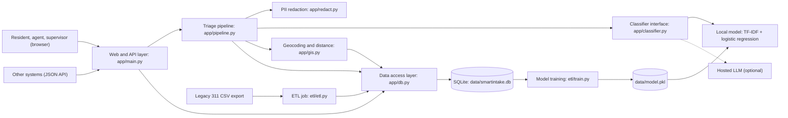

# System Architecture

## 1. Architectural Style

- **Pattern:** Layered modular monolith with a pipes-and-filters core. One FastAPI process holds a
  presentation layer (Jinja2 templates and routes in `app/main.py`), a domain layer (the triage
  pipeline in `app/pipeline.py` and its filters) and a data access layer (`app/db.py` over SQLite).
  Data preparation (`etl/`) runs as separate batch jobs that share the same data access layer.
- **Rationale:**
  - **Maintainability:** each pipeline stage (redaction, safety screen, classification, geocoding,
    duplicate detection, routing) is its own small module with one job, so a stage can be changed
    or replaced without touching the others. The pipeline takes a database connection and a
    classifier as arguments, which keeps it testable without the web layer.
  - **Replaceable integrations:** the classifier, the GIS lookup and the work management system
    are the three parts a real city would swap for its own services. Each sits behind a narrow
    interface (`classify(text)`, `geocode(conn, address)`, the `work_order` table).
  - **Performance and simplicity:** everything runs in one process with a local database file, so
    there is no network hop between stages. The benchmark recorded in `docs/reports/benchmark.txt`
    shows about 1,000 requests per second with a mean of about 1 ms per request on the local model.
  - **Scalability trade-off:** a monolith on SQLite suits a prototype and a pilot. It does not
    scale horizontally; section 4 records this as an accepted trade-off.

## 2. Component Interaction Diagram (Mermaid)

Solid arrows are calls made on every request. The dashed arrow is used only when an API key is
configured. The lower part of the diagram is the offline batch path that prepares the training data
and the model before the web application starts.

## 3. Data Flow & Execution Lifecycle

1. **Ingestion:** a request arrives either from the resident web form (`POST /requests`) or from
   another system as JSON (`POST /api/requests`). FastAPI and the Pydantic model `RequestIn` check
   the text length, the channel value and the field sizes before any domain code runs. The route
   opens one database session, which commits on success and rolls back on any error.
2. **Processing:** `pipeline.process_request` runs the stages in a fixed order:
   1. `redact` replaces e-mail addresses, phone numbers and names with placeholders.
   2. `safety_hit` checks the redacted text against the safety keyword list. A hit marks the
      request `URGENT` and forces human review.
   3. The classifier returns a category and a confidence value.
   4. `gis.geocode` turns the address into coordinates and a ward.
   5. The request is flagged for review if it hit a safety keyword, if confidence is below the
      configured threshold (default 0.80), or if the address could not be located.
   6. Otherwise `route` looks for an open work order of the same category within the configured
      radius (default 50 m) and time window (default 14 days). If one exists the request is marked
      `DUPLICATE` and attached to it; if not, a new work order is created with a due time taken
      from the category's service-level hours.
3. **Persistence & Response:** the request row, any work order and a resident notification are
   written in the same transaction, together with the measured processing time. The API returns the
   ticket number, status, category, confidence and review reason; the web form redirects to
   `/track/{ticket}`. Flagged requests wait in the agent queue (`/agent`); when an agent confirms or
   corrects them, an `agent_review` row records the decision and the request continues through
   `route`. Advancing a work order notifies every linked request and closes them on completion.

## 4. Architecture Decision Records (ADRs)

- **ADR-01 (Safety screen before the model):** *Context:* a misrouted gas leak or downed wire is
  far more costly than a misrouted pothole. *Decision:* a fixed keyword screen runs before either
  classifier backend, and any hit goes to a person regardless of model confidence. *Trade-off:*
  some harmless requests that contain words such as "fire" are reviewed by hand.
- **ADR-02 (Two classifier backends behind one interface):** *Context:* a hosted LLM classifies
  free text well but needs an API key, network access and a privacy agreement. *Decision:* both
  backends implement `classify(text) -> Prediction`; the local scikit-learn model is the default
  and the LLM is used only when `ANTHROPIC_API_KEY` is set. *Trade-off:* two code paths to test,
  and the local model must be retrained when categories change.
- **ADR-03 (Redact before storing or sending):** *Context:* residents put names, phone numbers and
  e-mail addresses in free text. *Decision:* redaction is the first pipeline stage, so only
  redacted text is stored or sent to a classifier. *Trade-off:* pattern-based redaction can miss
  unusual formats; contact details the resident enters in the dedicated contact field are still
  stored so they can be notified.
- **ADR-04 (Confidence threshold with human review):** *Context:* no classifier is always right.
  *Decision:* requests below a confidence threshold go to an agent, and a supervisor can change
  the threshold and the duplicate radius at run time through the `setting` table. *Trade-off:* a
  higher threshold means fewer wrong routes but more manual work.
- **ADR-05 (SQLite and a single process):** *Context:* the prototype must run on a laptop and in a
  single container with no external services. *Decision:* one SQLite file accessed through
  `app/db.py`. *Trade-off:* one writer at a time and no horizontal scaling; moving to a server
  database would be confined to the data access layer.
- **ADR-06 (Train the model at image build time):** *Context:* the image should start with no
  manual setup. *Decision:* the `Dockerfile` generates the synthetic history, runs the ETL and
  trains the model during `docker build`. *Trade-off:* longer builds and a larger image, and data
  written at run time is lost when the container is removed unless a volume is mounted.
